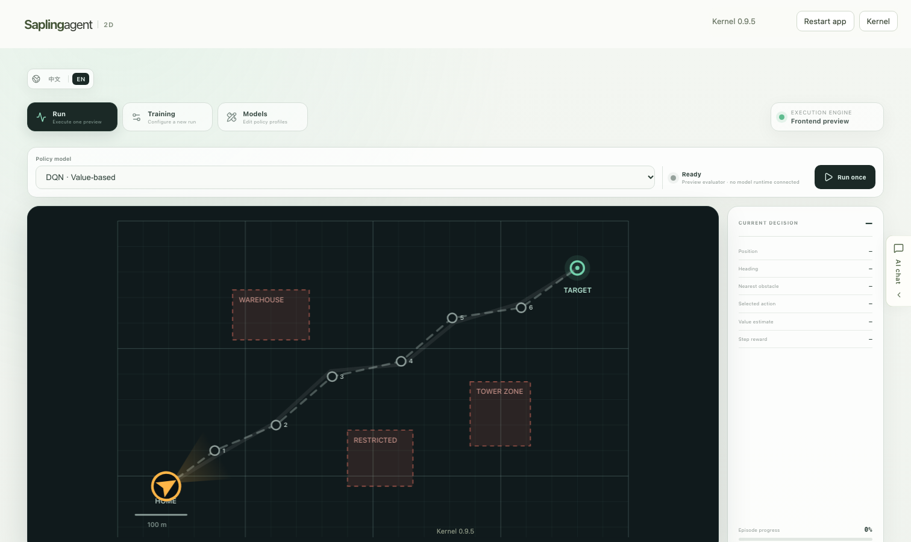

# Drone Ranger RL Studio

Drone Ranger RL Studio is a local, AI-assisted workspace for exploring 2D drone navigation with reinforcement-learning policy profiles. It combines a responsive React dashboard with Saplingagent's project-local chat, file tools, runtime controls and model-provider integrations.

The current application is an interactive visualization and workflow prototype. It lets you inspect deterministic route previews, prepare training configurations and edit model metadata, but it does **not** yet run a simulator, train a policy or load a real checkpoint.



<p align="center"><sub>Current Run workspace · DQN frontend preview · AI chat collapsed</sub></p>

## What is included

- **Run workspace** — compare DQN, PPO, SAC and A2C route previews in a `1000 × 620` world, start or stop a deterministic episode animation and inspect decision-step data.
- **Mission editing** — change waypoint coordinates and obstacle labels, positions and dimensions; the preview route and clearance values update from the in-memory mission state.
- **Training workspace** — prepare environment, workload, rollout, optimization, evaluation, checkpoint, seed and device settings.
- **Model workspace** — inspect reference network diagrams and edit local policy-profile drafts.
- **English and Simplified Chinese UI** — switch the complete Drone Ranger dashboard language from the page.
- **Integrated AI chat** — use the right-side Saplingagent panel for project-aware conversations, file/image attachments and code changes.
- **Local runtime controls** — configure an AI provider, restart owned project services and keep source, conversations and credentials inside the application folder.

## Current status and limitations

The values currently shown for rewards, success rates, routes, decisions and hyperparameters are preview data defined in the frontend. Training settings and model edits remain local, in-memory drafts.

The following capabilities are not implemented yet:

- Gymnasium or another drone simulation environment
- a Python training/inference service
- real DQN, PPO, SAC or A2C checkpoint loading
- live drone telemetry or hardware control
- persistent training jobs, metrics and model artifacts

Do not use the current visualization as evidence of real policy performance or flight safety. A future model runtime should expose a documented application API while leaving rendering independent from transport.

## Quick start

### Run the complete application

Requirements:

- macOS 13.5+ or Windows 10/11
- Git Bash on Windows
- internet access for first-time local dependency installation and the selected AI provider
- your own ChatGPT account or compatible API credentials for AI chat

Clone the project and run its unified launcher:

```bash
git clone https://github.com/secreat14/DroneRanger-RL-Studio.git
cd DroneRanger-RL-Studio
bash Saplingagent.sh
```

The launcher installs declared dependencies locally, opens project/AI configuration when needed and starts the application on an available loopback port. Follow the actual URL printed in the terminal; `5173` is only the initial preferred port.

Useful launcher actions:

```bash
bash Saplingagent.sh configure
bash Saplingagent.sh start --no-open
bash Saplingagent.sh doctor
bash Saplingagent.sh install --repair
```

Closing the browser tab does not stop project services. Use the generated application controls or stop the launcher process normally.

### Run only the frontend for development

The full application launcher manages a project-local Node runtime. If Node is already available for frontend work:

```bash
cd front
npm ci
npm run dev -- --port 5173
```

Vite proxies `/api` to the local Agent runtime, which defaults to `127.0.0.1:4310`. To use another Agent port:

```bash
SEED_AGENT_PORT=4410 npm run dev -- --port 5173
```

Frontend-only mode can render the Drone Ranger workspace, but AI chat and runtime actions require the corresponding backend services.

## Using the workspace

### Run

1. Select DQN, PPO, SAC or A2C.
2. Choose **Run once** to generate and animate the deterministic preview trace.
3. Inspect position, heading, obstacle clearance, selected action, value estimate and step reward.
4. Edit navigation points or obstacles in the mission-input tables and run the preview again.

All coordinates use the same `1000 × 620` world system. Changes are held in browser memory and do not update a simulator or environment file.

### Training

Prepare a reproducible training configuration, including environment name, total steps, episode limit, parallel environments, rollout size, learning rate, batch size, discount factor, gradient clipping, evaluation cadence, checkpoint cadence, seed and device.

Saving currently confirms only the local form state. It does not start a training process or write a configuration file.

### Models

Review a reference architecture for each policy family and adjust its display name, description and core parameter fields. These diagrams and edits are UI reference data; they are not read from or written to model checkpoints.

### AI chat

Expand the right-side chat panel to discuss or modify the project. The chat supports saved conversations, streaming responses, Markdown and mathematics, local file/image attachments, context-usage reporting when available and project-page inspection. AI access depends on the provider configured through `bash Saplingagent.sh configure`.

## Development and verification

Frontend checks:

```bash
cd front
npm test
npm run build
```

Recommended manual checks after UI changes:

1. Confirm **Run** is the default workspace.
2. Switch between Run, Training and Models.
3. Switch all four policy profiles.
4. Run a full preview episode and inspect the decision table.
5. Edit waypoint and obstacle inputs.
6. Exercise the training and model forms.
7. Switch between English and Chinese.
8. Expand and collapse the AI chat without losing the current dashboard state.

Automated frontend tests and a successful build verify the interface code only. They do not validate model quality, training correctness, provider quota or real drone behavior.

## Project structure

```text
Drone-Ranger-RL-agent/
├── front/
│   ├── features/drone-ranger/  # Dashboard, preview evaluator and styles
│   ├── chat/                    # Collapsible Saplingagent chat UI
│   └── main.tsx                 # Frontend entry
├── backend/
│   ├── agent-runtime/           # AI engine sessions and HTTP/SSE API
│   ├── workspace/               # Local conversations and preferences
│   ├── app-builder/             # Project file and command tools
│   ├── mcp-runtime/             # Project MCP tools
│   └── runtime-manager/         # Service startup and restart control
├── kernel/                      # Installer, launcher, setup UI and engine adapters
├── config/                      # Application runtime configuration
├── .agents/skills/              # Project-local AI workflows
├── docs/                        # Human-facing technical documentation
├── rules/                       # AI development and task-control rules
├── data/                        # Local application data; not source delivery
└── Saplingagent.sh              # Unified launcher
```

The Drone Ranger feature is application-owned code under `front/features/drone-ranger/`. Platform installation, provider setup and runtime management remain in `kernel/`. Credentials are stored under ignored `local-secrets/` paths and must not be committed.

## Technology

- React 19 and TypeScript
- Vite 8
- HTML Canvas for the 2D mission view
- assistant-ui for the embedded AI conversation panel
- Saplingagent kernel `0.9.5`
- Codex App Server, OpenCode or Claude Agent as configurable AI engines

## Documentation

- [Drone Ranger frontend notes](front/features/drone-ranger/README.md)
- [Frontend service guide](front/README.md)
- [Frontend contract](front/CONTRACT.md)
- [Frontend deployment guide](front/DEPLOY.md)
- [Project service guide](docs/project-services.html)
- [AI configuration guide](docs/ai-configuration.html)
- [Project launcher guide](docs/project-launcher.html)
- [Development rules](rules/README.md)

## License

Project-owned source is provided under the [PolyForm Noncommercial License 1.0.0](LICENSE). Third-party packages retain their own licenses; see [THIRD_PARTY_NOTICES.md](THIRD_PARTY_NOTICES.md).

Saplingagent and Drone Ranger RL Studio are independent projects and are not official products of OpenAI, Anthropic or any model provider. Model access, eligibility and usage costs follow the account or API provider configured by the user.
